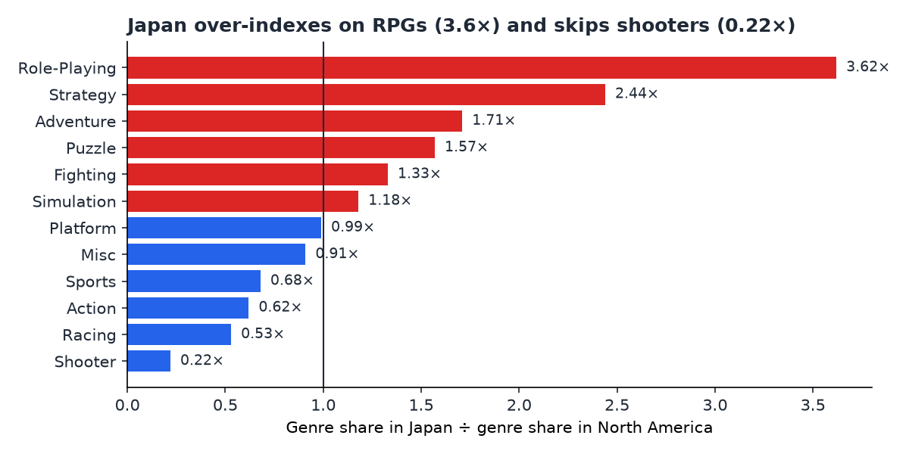
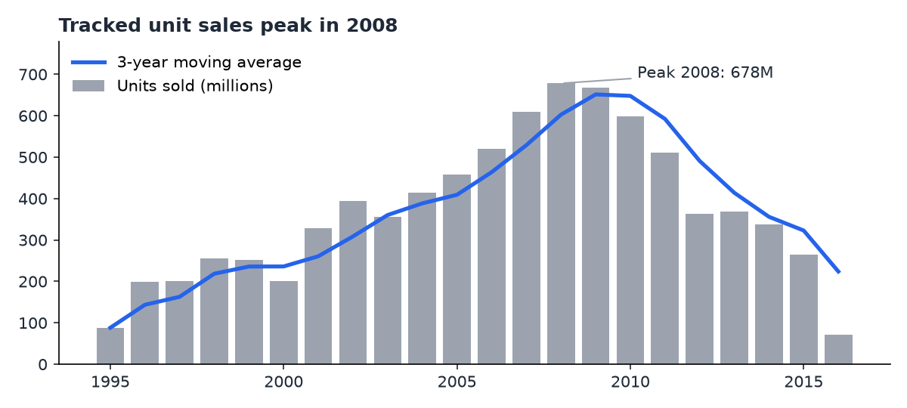
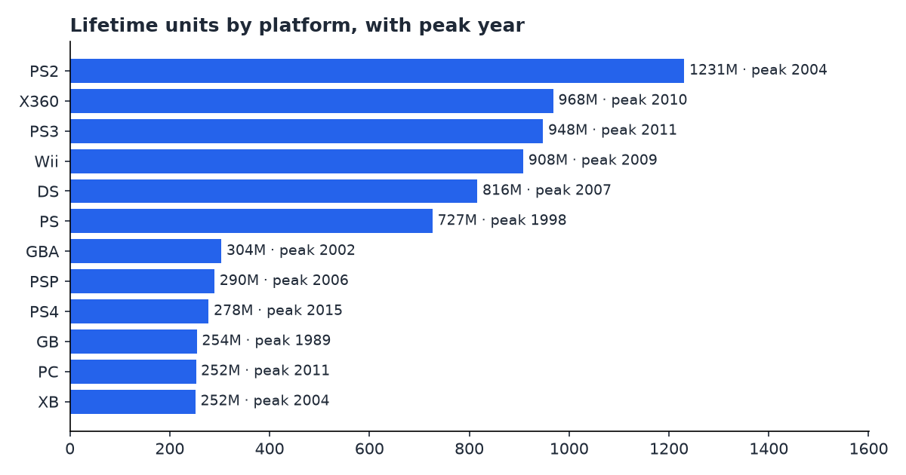

# Video Game Sales Analytics & Forecasting

An end-to-end analytics project on **16,187 video game releases (1980–2016)**:
- a Python ETL into a **SQLite star schema**
- five **SQL analyses** built on CTEs and window functions
- a **scikit-learn** model that forecasts regional sales for new titles

## Key findings
| Question | Answer |
|---|---|
| Who leads each region? | **Nintendo** is #1 in North America (18.9% of units), Europe (17.4%), and Japan (35.5%). **EA** leads the rest of the world (16.2%). |
| How do tastes differ by region? | Japan buys **role-playing games at 3.6×** North America's share, and **shooters at only 0.22×**. |
| How has the genre mix shifted? | Platformers were 32.5% of 1980s units. In the 2010s, Action (26.7%) and Shooters (18.4%) dominate. |
| Which platform sold the most? | The **PS2**: 1.23B tracked units over 12 years, peaking in 2004. |
| When did tracked sales peak? | **2008, at 678M units**. Later years decline, partly because the source tracks boxed retail and its recent years are incomplete. |





## Forecasting new releases (honest results)
Model: one-hot platform, genre, and publisher (top 40 + "Other") plus release year, fed into `HistGradientBoostingRegressor`, trained on log sales.
**Time-based split:** trained on 14,120 titles released through 2012, tested on 2,067 titles from 2013–2016.

| Region | R² | MAE (M units) | Naive-median MAE | Improvement |
|---|---|---|---|---|
| North America | 0.19 | 0.186 | 0.209 | 11.1% |
| Europe | 0.10 | 0.164 | 0.177 | 7.3% |
| Japan | 0.18 | 0.064 | 0.065 | 1.6% |

**Takeaway:** metadata alone explains only a small share of a game's sales, because hits are driven by franchise, quality, and marketing that this dataset doesn't capture. The model beats a naive baseline most in North America. Next steps would be review scores, franchise flags, and pre-release search interest.

## Data model
`fact_sales` (game × region grain) with `dim_game`, `dim_platform`, `dim_genre`, `dim_publisher`, `dim_year`, and `dim_region`. See [data_dictionary.md](data_dictionary.md).

## Run it
```bash
pip install -r requirements.txt
python etl.py          # builds vgsales.db (16,598 raw rows -> 16,187 clean, 64,748 fact rows)
python run_queries.py  # runs queries.sql -> results/*.csv
python model.py        # forecasting metrics -> results/model_metrics.csv
python charts.py       # docs/*.png
python -m pytest       # ETL integrity tests (row counts, no orphan keys, totals reconcile to source)
```

## Data source
[Global Video Game Sales](https://www.kaggle.com/datasets/thedevastator/global-video-game-sales) by The Devastator on Kaggle (CC0: Public Domain), originally scraped from VGChartz. The file in `data/raw/` came from a [Hugging Face mirror](https://huggingface.co/datasets/haoxianc/thedevastator_global-video-game-sales) of that dataset. `data/raw/SOURCE.txt` records its row count and hash.

*Author: Elijah Villa, MIS @ University of Arizona*
