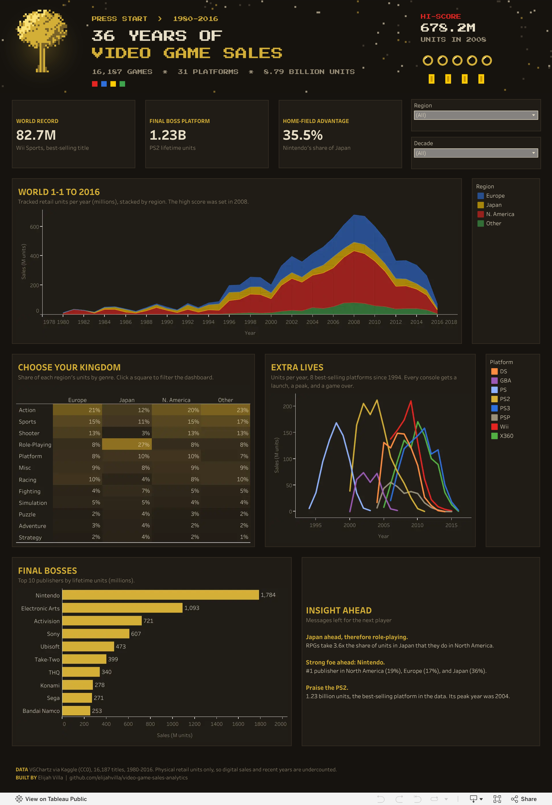
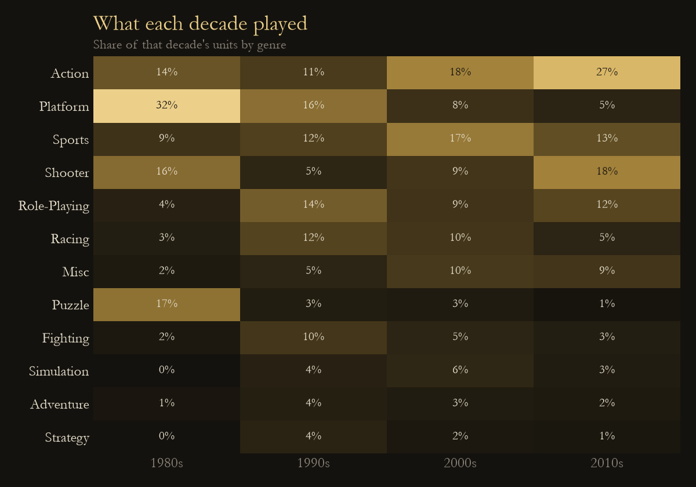

# Video Game Sales Analytics

I've played games my whole life (Elden Ring is my favorite), and I wanted to answer some questions I've always had about the industry with real data. Which publishers own which regions? Do players in Japan really buy different games than players in the US? Can you predict how a new game will sell from basic facts like its platform and genre?

This project takes about 16,000 games released between 1980 and 2016, loads them into a small data warehouse, digs into them with SQL, and tests a forecasting model. The chart colors are a nod to the Lands Between.

## Interactive dashboard

**[Open it on Tableau Public](https://public.tableau.com/app/profile/elijah.villa/viz/vgsales_dashboard_17954664879300/VideoGameSales1980-2016)**. You can filter by region and decade, and clicking a genre in the heatmap filters the rest of the dashboard.

[](https://public.tableau.com/app/profile/elijah.villa/viz/vgsales_dashboard_17954664879300/VideoGameSales1980-2016)

I themed it after the games I grew up on. The regions are colored Mario red, Sonic blue, Pokémon yellow, and Zelda green, the pixel-art header is original, and the takeaways are written as Elden Ring ground messages.


## What I found

- Nintendo is the top publisher in North America (19% of units), Europe (17%), and Japan, where it holds 36% of the market. EA leads everywhere else.
- Japan really does play different games. Role-playing games take 3.6 times the share of sales they do in North America, while shooters barely register (0.22x).
- The genre mix flipped over time. Platformers were a third of all units in the 1980s. By the 2010s, action and shooter games made up almost half.
- The PS2 is the best-selling platform in the data at 1.23 billion units, and it peaked in 2004.
- Tracked sales peak in 2008 at 678 million units. The drop after that is partly real and partly because the source tracks boxed retail copies, so digital sales and recent years are undercounted.



## Can you predict sales for a new game?

I trained a gradient boosting model (scikit-learn) on games released through 2012, then tested it on 2,067 games from 2013 to 2016, the way you would forecast real upcoming releases. Inputs are platform, genre, publisher, and release year.

| Region | R² | Avg error (millions of units) | Error if you just guess the median | Improvement |
|---|---|---|---|---|
| North America | 0.19 | 0.186 | 0.209 | 11% |
| Europe | 0.10 | 0.164 | 0.177 | 7% |
| Japan | 0.18 | 0.064 | 0.065 | 2% |

The short answer is: a little. The model beats a naive guess, mostly in North America, but platform and genre only explain a small part of why a game sells. What really drives sales (franchise, reviews, marketing) isn't in this dataset. If I take this further, review scores and franchise flags are the first things I'd add.


## How it's built

1. `etl.py` cleans the raw file (16,598 rows down to 16,187 after removing games with no release year or publisher). It then loads a SQLite star schema: one fact table of sales by game and region (64,748 rows) and dimension tables for game, platform, genre, publisher, year, and region. The tables are documented in [data_dictionary.md](data_dictionary.md).
2. `queries.sql` holds the five analyses. They use CTEs and window functions (RANK, ROW_NUMBER, LAG, running averages).
3. `model.py` trains and scores the forecast.
4. `charts.py` makes the charts.
5. `tableau_export.py` flattens the star schema into one tidy table for Tableau, at the same grain as the fact table. A test confirms its row count and sales total match the warehouse exactly.
6. The dashboard is built as code. `tableau/build_workbook.py` writes the Tableau workbook XML (sheets, layout, colors, text), `tableau/make_extract.py` builds the `.hyper` extract that Tableau Public requires, and `tableau/make_header.py` draws the pixel-art header.
7. `tests/` checks that row counts are right, no fact row points to a missing dimension, and sales totals match the raw file exactly.

To run it:

```
pip install -r requirements.txt
python etl.py
python run_queries.py
python model.py
python charts.py
python -m pytest
```

To rebuild the dashboard (needs `pip install -r requirements-tableau.txt` and Tableau Public Desktop):

```
python tableau_export.py
python tableau/make_extract.py
python tableau/make_header.py <path to PressStart2P-Regular.ttf>
python tableau/build_workbook.py
```

Then open `tableau/vgsales_dashboard.twb`. `build_workbook.py` also registers the custom color palettes in Tableau's `Preferences.tps`, which is where Desktop loads them from. Assign the "Game Regions" and "Game Platforms" palettes to the two legends once (Edit Colors, then Assign Palette).

## Data

[Global Video Game Sales](https://www.kaggle.com/datasets/thedevastator/global-video-game-sales) on Kaggle (public domain, CC0), originally scraped from VGChartz. My copy came from a [Hugging Face mirror](https://huggingface.co/datasets/haoxianc/thedevastator_global-video-game-sales) of the same file, and `data/raw/SOURCE.txt` records its row count and hash.

Elijah Villa, Management Information Systems, University of Arizona
